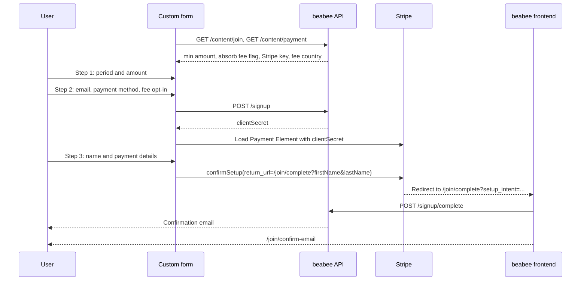
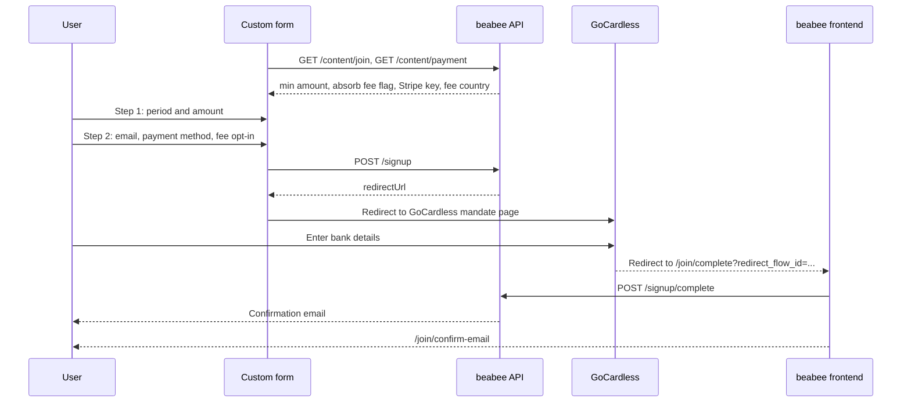

# Custom signup flow for beabee

A reference implementation of a custom signup form that talks directly to the
beabee API. Use it as a starting point when the built-in join page at
`/join` doesn't fit your site's design or needs to live on another domain.

The form is plain HTML and JavaScript. It handles choosing a contribution,
collecting an email address and handing the user over to the payment
provider. Everything after the payment provider redirects back is handled by
the beabee frontend.

## Quick start

```
npm install
npm start
```

Set `frontendUrl` at the top of `src/main.js` to your beabee instance before
starting. The form then runs on http://localhost:1337.

## Prerequisites on the beabee instance

* At least one payment method configured in the membership builder. The form
  hardcodes direct debit, card and PayPal; remove the ones your instance
  doesn't offer.
* The origin the form is served from, including the port, listed in the
  `BEABEE_TRUSTEDORIGINS` environment variable. The API rejects cross-origin
  requests from any other origin.
* The `@beabee/beabee-common` package, which provides the fee calculation and
  the payment method constants used by the API.

## How the flow works

The form has three steps:

1. Period and amount
2. Email address, payment method and fee opt-in
3. Name and payment details, only for Stripe payment methods

On submit of step 2 the form calls `POST /signup`. For direct debit the API
returns a URL to redirect the user to GoCardless. For Stripe methods it returns
a client secret that the form uses to show the Stripe Payment Element in step
3. In both cases the user ends up on `/join/complete` in the beabee frontend,
which completes the signup and sends a confirmation email.

### Card, PayPal and other Stripe methods



### Direct debit via GoCardless



## API endpoints

All endpoints are under `<frontendUrl>/api/1.0` and need no authentication.

### `GET /content/join`

Settings from the membership builder. The form uses:

| Field | Used for |
|---|---|
| `minMonthlyAmount` | Minimum custom amount. Annual minimum is twelve times this. |
| `showAbsorbFee` | Whether the fee opt-in is offered. |

Also available if you want to drive the form from the instance settings
instead of hardcoding them:

| Field | Contents |
|---|---|
| `periods` | `[{ name: 'monthly' \| 'annually', presetAmounts: number[] }]` |
| `initialAmount`, `initialPeriod` | Defaults for a fresh form |
| `paymentMethods` | Payment methods enabled on the instance |
| `showVatNumber` | Whether to collect a VAT number |

### `GET /content/payment`

| Field | Used for |
|---|---|
| `stripePublicKey` | Loading Stripe.js |
| `stripeCountry` | Fee estimate, one of `eu`, `gb`, `ca` |

Also available: `taxRateRecurring` and `noticeText` for showing tax
information next to the amount.

### `POST /signup`

Starts the signup. Request body:

```json
{
  "email": "user@example.com",
  "contribution": {
    "amount": 5,
    "period": "monthly",
    "payFee": true,
    "prorate": false,
    "paymentMethod": "s_card",
    "completeUrl": "https://your.beabee.instance.io/join/complete"
  },
  "loginUrl": "https://your.beabee.instance.io/auth/login",
  "setPasswordUrl": "https://your.beabee.instance.io/auth/set-password",
  "confirmUrl": "https://your.beabee.instance.io/join/confirm-email"
}
```

| Field | Rules |
|---|---|
| `email` | Valid email address |
| `contribution.amount` | At least `minMonthlyAmount`, or twelve times that for `annually` |
| `contribution.period` | `monthly` or `annually` |
| `contribution.payFee` | See [fee rules](#fee-rules) |
| `contribution.prorate` | Always `false` for new signups |
| `contribution.paymentMethod` | `gc_direct-debit`, `s_card`, `s_sepa`, `s_bacs`, `s_paypal` or `s_ideal` |
| `contribution.completeUrl` | Where the payment provider redirects to afterwards. Keep it on the beabee frontend. |
| `loginUrl`, `setPasswordUrl`, `confirmUrl` | Links used in the emails the API sends. Keep them on the beabee frontend. |

Optional fields:

| Field | Purpose |
|---|---|
| `origin` | `{ source, medium, campaign }` from UTM parameters, stored on the contact |
| `oneTimePayment` | `{ amount, payFee, paymentMethod, completeUrl }` for a one-off donation instead of `contribution` |

Response is one of:

| Response | Meaning |
|---|---|
| `200 { "redirectUrl": "..." }` | Send the user to this URL (GoCardless) |
| `200 { "clientSecret": "..." }` | Show the Stripe Payment Element with this secret |
| `400` | Validation failed, the body lists the failing fields |
| `429` | Rate limited, five signups per minute per IP |

### Completion

The redirect back from Stripe or GoCardless lands on `/join/complete` in the
beabee frontend, which calls `POST /signup/complete` and then shows
`/join/confirm-email`. The complete page reads these query parameters:

| Parameter | Set by |
|---|---|
| `setup_intent` | Stripe |
| `redirect_flow_id` | GoCardless |
| `firstName`, `lastName` | Your form, via the Stripe `return_url` |
| `vatNumber` | Your form, optional |

GoCardless collects the name itself, so it is only passed for Stripe.

## Stripe integration

Step 3 uses the Stripe Payment Element with the client secret from
`POST /signup`:

* Create `stripe.elements({ clientSecret })` and a `payment` element with
  `fields.billingDetails.email` and `name` set to `'never'`. The form
  collects these itself and passes them in `confirmSetup`.
* Pass `applePay.recurringPaymentRequest` with the amount in cents and the
  interval, otherwise Apple Pay refuses recurring setup.
* Call `stripe.confirmSetup` with the `return_url` set to the complete URL plus
  `firstName` and `lastName`, and `billing_details` with email and full name.
  Stripe redirects to the return URL with `setup_intent` appended.

## Fee rules

`calcPaymentFee` from `@beabee/beabee-common` estimates the transaction fee
for an amount, period and payment method in the instance's fee country. The
API validates `payFee` with these rules:

* `false` when `showAbsorbFee` is off on the instance
* `false` for annual contributions
* `true` for monthly contributions of exactly 1

The form hides the opt-in and sends `false` in the first two cases, and shows
a disabled, checked box in the third.

## Emails and existing accounts

`POST /signup` always succeeds for a valid request, regardless of whether the
email address is already known. After the payment flow completes, the API
sends one of:

| Situation | Email |
|---|---|
| New contact or inactive membership | Confirm email, linking to `confirmUrl/<id>` |
| Active membership, has a password | Already registered, linking to `loginUrl` |
| Active membership, no password | Set password, linking to `setPasswordUrl/<id>` |

Confirming the email creates the contact and logs them in. A confirm link for
an address that gained an active membership in the meantime fails with a
`duplicate-email` error.

## Adapting the form

* Preset amounts, periods and payment methods are hardcoded in `index.html`.
  Read them from `GET /content/join` if you want the membership builder to
  control them.
* The Stripe Payment Element can be themed through `stripeAppearance` in
  `src/main.js`, see the Stripe appearance API docs.
* Everything after the payment provider redirect uses the beabee frontend.
  Keep `completeUrl`, `loginUrl`, `setPasswordUrl` and `confirmUrl` pointing
  there unless you also reimplement those pages.
