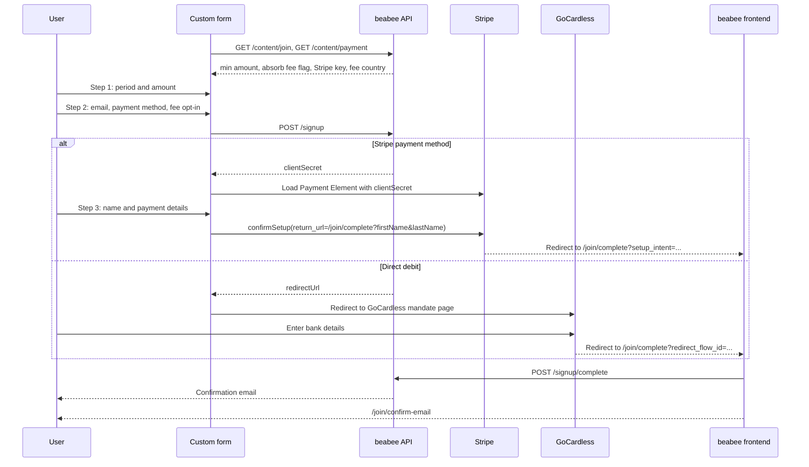

This is a reference implementation for creating a custom form for beabee's
signup flow

```
npm install
npm start
```

The form requirements are:
* Show different contribution amounts depending on the selected period
* Allow users to enter a custom amount instead of one of the presets
* Allow monthly users to opt-in to absorbing the transaction fee
   * Only shown if the instance has the absorb fee option enabled (enforced by API)
   * Force €1/month users to absorb the transaction fee (enforced by API)
* Disable fee opt-in for annual contributors (enforced by API)

The form loads the instance's settings from the API before use:
* `/content/join` for the minimum contribution amount and whether the absorb
  fee option is enabled
* `/content/payment` for the Stripe public key and the country used to
  estimate transaction fees

The API only accepts requests from origins listed in the instance's
`BEABEE_TRUSTEDORIGINS` setting, so the domain hosting the form must be added
there.

## How the form talks to beabee and Stripe



The custom form only handles the steps up to the payment provider. The
redirect back lands on the beabee frontend, which completes the signup and
asks the user to confirm their email address.
