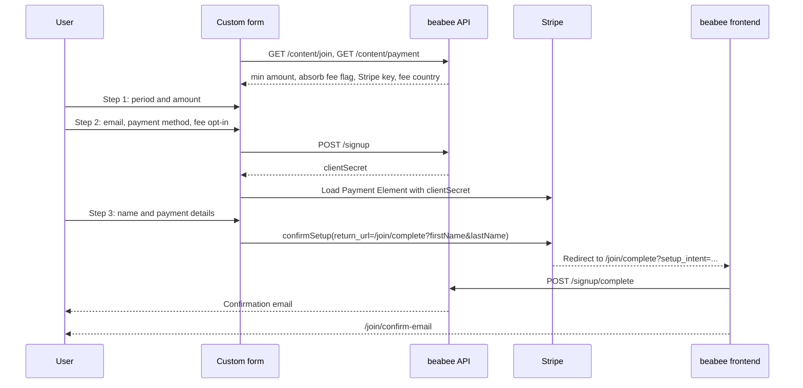
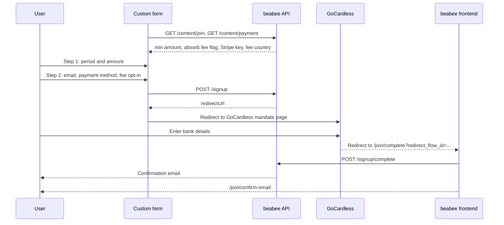

# Custom signup flow with a contribution

A reference implementation of a custom signup form for a beabee instance where
members pay a recurring contribution, which is the default. Use it as a
starting point when the built-in join page at `/join` doesn't fit your site's
design or needs to live on another domain. For an instance with
`hideContribution` enabled, see the
[no-contribution example](../no-contribution/README.md) instead.

The form is plain HTML and JavaScript. It handles choosing a contribution,
collecting an email address and handing the user over to the payment
provider. Everything after the payment provider redirects back is handled by
the beabee frontend.

## Quick start

```
npm install
npm start
```

Set `frontendUrl` at the top of `src/main.js` to your beabee instance before
starting. The form then runs on http://localhost:1337.

## Prerequisites on the beabee instance

* At least one payment method configured in the membership builder. The form
  hardcodes direct debit, card and PayPal; remove the ones your instance
  doesn't offer.
* The origin the form is served from, including the port, listed in the
  `BEABEE_TRUSTEDORIGINS` environment variable. The API rejects cross-origin
  requests from any other origin. The same list decides which origins are
  accepted in `postConfirmUrl` and the email link URLs.
* The `@beabee/beabee-common` package, which provides the fee calculation and
  the payment method constants used by the API.

## How the flow works

The form has three steps:

1. Period and amount
2. Email address, payment method and fee opt-in
3. Name and payment details, only for Stripe payment methods

On submit of step 2 the form calls `POST /signup`. For direct debit the API
returns a URL to redirect the user to GoCardless. For Stripe methods it returns
a client secret that the form uses to show the Stripe Payment Element in step
3. In both cases the user ends up on `/join/complete` in the beabee frontend,
which completes the signup and sends a confirmation email.

### Card, PayPal and other Stripe methods



### Direct debit via GoCardless



## API endpoints

All endpoints are under `<frontendUrl>/api/1.0` and need no authentication.

### `GET /content/join`

Settings from the membership builder. The form uses:

| Field | Used for |
|---|---|
| `minMonthlyAmount` | Minimum custom amount. Annual minimum is twelve times this. |
| `showAbsorbFee` | Whether the fee opt-in is offered. |

Also available if you want to drive the form from the instance settings
instead of hardcoding them:

| Field | Contents |
|---|---|
| `periods` | `[{ name: 'monthly' \| 'annually', presetAmounts: number[] }]` |
| `initialAmount`, `initialPeriod` | Defaults for a fresh form |
| `paymentMethods` | Payment methods enabled on the instance |
| `showVatNumber` | Whether to collect a VAT number |

### `GET /content/payment`

| Field | Used for |
|---|---|
| `stripePublicKey` | Loading Stripe.js |
| `stripeCountry` | Fee estimate, one of `eu`, `gb`, `ca` |

Also available: `taxRateRecurring` and `noticeText` for showing tax
information next to the amount.

### `GET /content/join/setup`

Settings for the setup step after email confirmation. Use them to build a
newsletter opt-in into your form:

| Field | Used for |
|---|---|
| `showNewsletterOptIn` | Whether the instance asks about the newsletter at all |
| `newsletterTitle`, `newsletterText`, `newsletterOptIn` | Heading, description and checkbox label from the membership builder |
| `newsletterGroups` | `[{ id, label, checked }]`, the groups the user can pick and whether each is checked by default |

### `POST /signup`

Starts the signup. Request body:

```json
{
  "email": "user@example.com",
  "contribution": {
    "amount": 5,
    "period": "monthly",
    "payFee": true,
    "prorate": false,
    "paymentMethod": "s_card",
    "completeUrl": "https://your.beabee.instance.io/join/complete"
  }
}
```

| Field | Rules |
|---|---|
| `email` | Valid email address |
| `contribution.amount` | At least `minMonthlyAmount`, or twelve times that for `annually` |
| `contribution.period` | `monthly` or `annually` |
| `contribution.payFee` | See [fee rules](#fee-rules) |
| `contribution.prorate` | Always `false` for new signups |
| `contribution.paymentMethod` | `gc_direct-debit`, `s_card`, `s_sepa`, `s_bacs`, `s_paypal` or `s_ideal` |
| `contribution.completeUrl` | Where the payment provider redirects to afterwards. Keep it on the beabee frontend. |

Optional fields:

| Field | Purpose |
|---|---|
| `origin` | `{ source, medium, campaign }` from UTM parameters, stored on the contact |
| `oneTimePayment` | `{ amount, payFee, paymentMethod, completeUrl }` for a one-off donation instead of `contribution` |
| `password` | Sets the password up front so `/join/setup` doesn't have to ask for it. At least 8 characters with a lower case letter, an upper case letter and a digit. Rejected when the instance uses OIDC login. |
| `newsletterStatus` | `subscribed`, `unsubscribed`, `pending`, `cleaned` or `none`. Applied when the email is confirmed, see [newsletter preferences](#newsletter-preferences). |
| `newsletterGroups` | Array of group ids from `GET /content/join/setup`. Only meaningful together with `newsletterStatus: "subscribed"`. |
| `postConfirmUrl` | Where the beabee frontend sends the user after they confirm their email, instead of `/join/setup`. A path on the instance, or an absolute URL on the instance's origin or one in `BEABEE_TRUSTEDORIGINS`. See [after confirmation](#after-confirmation). |
| `loginUrl`, `setPasswordUrl`, `confirmUrl` | Override the links in the emails the API sends. Default to `/auth/login`, `/auth/set-password` and `/join/confirm-email` on the instance. Only needed if you reimplement those pages, and must be absolute URLs on the instance's origin or one in `BEABEE_TRUSTEDORIGINS`. |

`contribution` itself is optional to the API. Leaving out both `contribution`
and `oneTimePayment` starts a signup without a payment, which the
[no-contribution example](../no-contribution/README.md) covers.

Response is one of:

| Response | Meaning |
|---|---|
| `200 { "redirectUrl": "..." }` | Send the user to this URL (GoCardless) |
| `200 { "clientSecret": "..." }` | Show the Stripe Payment Element with this secret |
| `400` | Validation failed, the body lists the failing fields |
| `429` | Rate limited, five signups per minute per IP |

### Completion

The redirect back from Stripe or GoCardless lands on `/join/complete` in the
beabee frontend, which calls `POST /signup/complete` and then shows
`/join/confirm-email`. The complete page reads these query parameters:

| Parameter | Set by |
|---|---|
| `setup_intent` | Stripe |
| `redirect_flow_id` | GoCardless |
| `firstName`, `lastName` | Your form, via the Stripe `return_url` |
| `vatNumber` | Your form, optional |

GoCardless collects the name itself, so it is only passed for Stripe.

### Confirmation

The confirmation email links to `/join/confirm-email/<id>`. The beabee
frontend page at that URL calls `POST /signup/confirm-email` with the id,
which creates the contact, starts the contribution and logs them in. The
response is:

```json
{
  "postConfirmUrl": null,
  "paymentClientSecret": "seti_..."
}
```

`paymentClientSecret` is only set when the first payment needs the user to
authenticate it, for example with 3D Secure. The frontend runs that
challenge before continuing. A failed challenge still continues, the
contact is signed up and logged in either way, and Stripe expires the
subscription if the payment is never authenticated.

The custom form is not involved in any of this.

### After confirmation

By default the frontend continues to `/join/setup` after confirming the
email, where the user sets a password and the address opt-in configured in
the membership builder. The name is already known from the payment step.
The newsletter opt-in is shown there too, unless the form already sent it
with the signup.

Send `postConfirmUrl` with the signup to continue somewhere else instead,
for example a welcome page on your own site. The user is logged in to the
instance at that point. A path such as `/profile` stays inside the beabee
frontend; an absolute URL is loaded as a new page and must be on the
instance's origin or one listed in `BEABEE_TRUSTEDORIGINS`, which the
form's own origin already is. With OIDC login the frontend sends the user to
the identity provider to set up their credential first and returns to the
URL afterwards.

Skipping `/join/setup` also skips everything it collects. Send `password`
with the signup or rely on OIDC login, otherwise the contact has no
password and has to use the reset flow to log in again.

## Stripe integration

Step 3 uses the Stripe Payment Element with the client secret from
`POST /signup`:

* Create `stripe.elements({ clientSecret })` and a `payment` element with
  `fields.billingDetails.email` and `name` set to `'never'`. The form
  collects these itself and passes them in `confirmSetup`.
* Pass `applePay.recurringPaymentRequest` with the amount in cents and the
  interval, otherwise Apple Pay refuses recurring setup.
* Call `stripe.confirmSetup` with the `return_url` set to the complete URL plus
  `firstName` and `lastName`, and `billing_details` with email and full name.
  Stripe redirects to the return URL with `setup_intent` appended.

## Fee rules

`calcPaymentFee` from `@beabee/beabee-common` estimates the transaction fee
for an amount, period and payment method in the instance's fee country. The
API validates `payFee` with these rules:

* `false` when `showAbsorbFee` is off on the instance
* `false` for annual contributions
* `true` for monthly contributions of exactly 1

The form hides the opt-in and sends `false` in the first two cases, and shows
a disabled, checked box in the third.

## Newsletter preferences

`POST /signup` accepts `newsletterStatus` and `newsletterGroups`. They are
stored with the signup and applied to the contact when the email is
confirmed, so the user doesn't have to set them again on `/join/setup`.

* Leaving them out gives a new contact the instance's default newsletter
  status.
* An address that already belongs to a contact only has its preferences
  changed when `newsletterStatus` is `subscribed`. Re-joining can never
  unsubscribe someone.
* Group ids that no longer exist on the instance are dropped silently, so a
  cached list of groups won't make the signup fail.
* The `/join/setup` page still shows the opt-in when the instance has groups,
  with the chosen groups pre-selected, and hides it when the contact is
  already subscribed and there are no groups.

Only offer the opt-in when `showNewsletterOptIn` from
`GET /content/join/setup` is on, and send `subscribed` only when the user
ticked the box. For an unticked box leave both fields out rather than sending
`unsubscribed`, so a new contact gets the instance default and an existing
contact keeps what they have.

## Emails and existing accounts

`POST /signup` always succeeds for a valid request, regardless of whether the
email address is already known. After the payment flow completes, the API
sends one of:

| Situation | Email |
|---|---|
| New contact or inactive membership | Confirm email, linking to `/join/confirm-email/<id>` |
| Active membership, has a password | Already registered, linking to `/auth/login` |
| Active membership, no password | Set password, linking to `/auth/set-password/<id>` |

The links point at the instance unless the signup set `confirmUrl`,
`loginUrl` or `setPasswordUrl`, in which case the `<id>` is appended to the
given URL in the same way.

Confirming the email creates the contact and logs them in. A confirm link for
an address that gained an active membership in the meantime fails with a
`duplicate-email` error.

## Adapting the form

* Preset amounts, periods and payment methods are hardcoded in `index.html`.
  Read them from `GET /content/join` if you want the membership builder to
  control them.
* The Stripe Payment Element can be themed through `stripeAppearance` in
  `src/main.js`, see the Stripe appearance API docs.
* Add a newsletter checkbox and group picker driven by
  `GET /content/join/setup` and send the result as `newsletterStatus` and
  `newsletterGroups`, see [newsletter preferences](#newsletter-preferences).
* Send `postConfirmUrl` to bring the user back to your site once their
  email is confirmed, see [after confirmation](#after-confirmation).
* Everything after the payment provider redirect uses the beabee frontend.
  Keep `completeUrl` pointing there, and only send `loginUrl`,
  `setPasswordUrl` or `confirmUrl` if you reimplement those pages.
