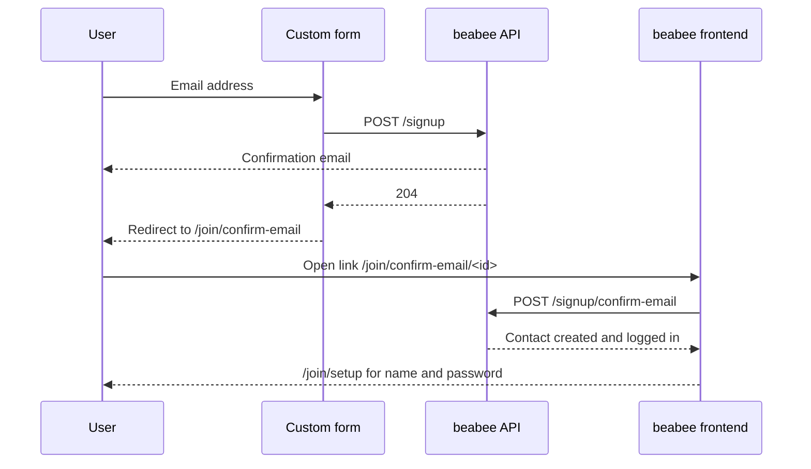

# Custom signup flow without a contribution

A reference implementation of a custom signup form for a beabee instance that
has `hideContribution` enabled. On such an instance signing up means nothing
more than registering an email address, so the form has a single field and
talks to the beabee API once. Use it as a starting point when the built-in
join page at `/join` doesn't fit your site's design or needs to live on
another domain.

The form is plain HTML and JavaScript with no build step. It collects the
email address, starts the signup and sends the user to the beabee frontend,
which handles email confirmation and account setup.

## Quick start

```
npm install
npm start
```

Set `frontendUrl` at the top of `src/main.js` to your beabee instance before
starting. The form then runs on http://localhost:1337.

## Prerequisites on the beabee instance

* `hideContribution` enabled in the general content settings. The API accepts
  a signup without a contribution regardless of this flag, but the frontend
  pages the user lands on afterwards only hide the contribution UI when it is
  set.
* The origin the form is served from, including the port, listed in the
  `BEABEE_TRUSTEDORIGINS` environment variable. The API rejects cross-origin
  requests from any other origin.

No payment provider is involved, so no Stripe key or payment method setup is
needed.

## How the flow works

On submit the form calls `POST /signup` with only the email address and the
URLs for the emails. The API stores the signup, sends the confirmation email
straight away and responds with `204`. The form then sends the user to
`/join/confirm-email` in the beabee frontend, which tells them to check their
inbox. Clicking the link in the email creates the contact, logs them in and
takes them to `/join/setup` to enter their name and password.



## API endpoints

All endpoints are under `<frontendUrl>/api/1.0` and need no authentication.

### `GET /content/join/setup`

Settings for the setup step after email confirmation. Use them to build a
newsletter opt-in into your form:

| Field | Used for |
|---|---|
| `showNewsletterOptIn` | Whether the instance asks about the newsletter at all |
| `newsletterTitle`, `newsletterText`, `newsletterOptIn` | Heading, description and checkbox label from the membership builder |
| `newsletterGroups` | `[{ id, label, checked }]`, the groups the user can pick and whether each is checked by default |

### `POST /signup`

Starts the signup. Request body:

```json
{
  "email": "user@example.com",
  "loginUrl": "https://your.beabee.instance.io/auth/login",
  "setPasswordUrl": "https://your.beabee.instance.io/auth/set-password",
  "confirmUrl": "https://your.beabee.instance.io/join/confirm-email"
}
```

| Field | Rules |
|---|---|
| `email` | Valid email address |
| `loginUrl`, `setPasswordUrl`, `confirmUrl` | Links used in the emails the API sends. Keep them on the beabee frontend. |

Optional fields:

| Field | Purpose |
|---|---|
| `origin` | `{ source, medium, campaign }` from UTM parameters, stored on the contact |
| `password` | Sets the password up front so `/join/setup` doesn't have to ask for it. At least 8 characters with a lower case letter, an upper case letter and a digit. Rejected when the instance uses OIDC login. |
| `newsletterStatus` | `subscribed`, `unsubscribed`, `pending`, `cleaned` or `none`. Applied when the email is confirmed, see [newsletter preferences](#newsletter-preferences). |
| `newsletterGroups` | Array of group ids from `GET /content/join/setup`. Only meaningful together with `newsletterStatus: "subscribed"`. |

Leaving out `contribution` and `oneTimePayment` is what makes this a signup
without a payment. Sending either starts a payment flow instead, see the
[contribution example](../contribution/README.md).

Response is one of:

| Response | Meaning |
|---|---|
| `204` | Signup started and confirmation email sent. There is no response body. |
| `400` | Validation failed, the body lists the failing fields |
| `429` | Rate limited, five signups per minute per IP |

### Confirmation

The confirmation email links to `confirmUrl/<id>`. The beabee frontend page
at that URL calls `POST /signup/confirm-email` with the id, which creates the
contact and logs them in. The frontend then continues to `/join/setup`, where
the user enters their name, a password and the address opt-in configured in
the membership builder. The newsletter opt-in is shown there too, unless the
form already sent it with the signup. With OIDC login the frontend sends the
user to the identity provider to set up their credential instead.

The custom form is not involved in any of this.

## Newsletter preferences

`POST /signup` accepts `newsletterStatus` and `newsletterGroups`. They are
stored with the signup and applied to the contact when the email is
confirmed, so the user doesn't have to set them again on `/join/setup`.

* Leaving them out gives a new contact the instance's default newsletter
  status.
* An address that already belongs to a contact only has its preferences
  changed when `newsletterStatus` is `subscribed`. Re-joining can never
  unsubscribe someone.
* Group ids that no longer exist on the instance are dropped silently, so a
  cached list of groups won't make the signup fail.
* The `/join/setup` page still shows the opt-in when the instance has groups,
  with the chosen groups pre-selected, and hides it when the contact is
  already subscribed and there are no groups.

Only offer the opt-in when `showNewsletterOptIn` from
`GET /content/join/setup` is on, and send `subscribed` only when the user
ticked the box. For an unticked box leave both fields out rather than sending
`unsubscribed`, so a new contact gets the instance default and an existing
contact keeps what they have.

## Emails and existing accounts

`POST /signup` always succeeds for a valid request, regardless of whether the
email address is already known. The API immediately sends one of:

| Situation | Email |
|---|---|
| New contact or inactive membership | Confirm email, linking to `confirmUrl/<id>` |
| Active membership, has a password | Already registered, linking to `loginUrl` |
| Active membership, no password | Set password, linking to `setPasswordUrl/<id>` |

Confirming the email creates the contact and sends the welcome email. If a
contact without an active membership already exists for the address, it is
updated rather than duplicated.

## Adapting the form

* Read UTM parameters from the page URL and pass them as `origin` if you want
  to track where signups come from.
* Add a password field and send it as `password` if you want to skip the
  password step on `/join/setup`. Don't offer it on instances with OIDC
  login.
* Add a newsletter checkbox and group picker driven by
  `GET /content/join/setup` and send the result as `newsletterStatus` and
  `newsletterGroups`, see [newsletter preferences](#newsletter-preferences).
* Everything after the signup uses the beabee frontend. Keep `loginUrl`,
  `setPasswordUrl` and `confirmUrl` pointing there unless you also
  reimplement those pages.
